# Skewness & Kurtosis: From Moments to Machine Learning #

## The mathematics, intuition, interpretation, and practical use of higher-order moments. ##

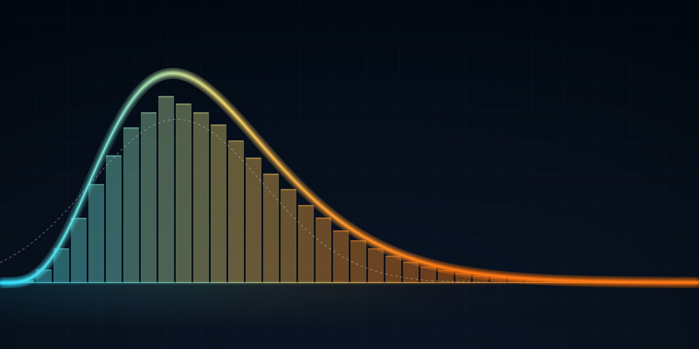 

-----

### Table of Contents ###


1. Why We Need Samples: Population vs. Sample
2. Why Divide by n − 1? Degrees of Freedom Explained
3. Moments: The Building Blocks of Shape
4. Skewness: Measuring Asymmetry

    4.1 Symmetric vs. Skewed Distributions

    4.2 Mean, Median and Mode in Skewed Data

    4.3 From the Third Central Moment to Skewness

    4.4 Sample Skewness: Fisher–Pearson and Bias Correction

    4.5 How to Interpret Skewness Values

5. Kurtosis: It’s About Tails, Not Peaks

    5.1 What Kurtosis Really Measures

    5.2 Why the Fourth Power?

    5.3 Excess Kurtosis: Where Does the “3” Come From?

    5.4 Leptokurtic, Mesokurtic and Platykurtic Distributions

    5.5 Sample Kurtosis and Fisher’s Correction

    5.6 Skewness vs. Kurtosis: The Memory Map

6. Calculating Skewness and Kurtosis in Python
7. Taming Skewness: Data Transformations

    7.1 Log Transformation

    7.2 Square Root Transformation

    7.3 Cube Root Transformation

    7.4 Box-Cox Transformation

    7.5 Yeo-Johnson Transformation

8. Standardization vs. Transformation
9. Kurtosis in Machine Learning
10. A Practical EDA Workflow
11. Resources

----

### 1. Why We Need Samples: Population vs. Sample ###

Would it be practical if I said, **“I want to find out the average marks of Class 12 students in the Non-Medical stream all over India”?**

I mean, who is going to visit every school in India, across every state, every district, and every village? That is next to impossible. And even if we somehow managed to collect all that data, it would require an enormous amount of time, money, and effort, with plenty of opportunities for errors and inconsistencies along the way.

So, can this problem not be solved?

*Absolutely!*

We can solve it using one of the most important concepts in statistics: **Population vs. Sample** .

I want you to look at this beautifully explained image:

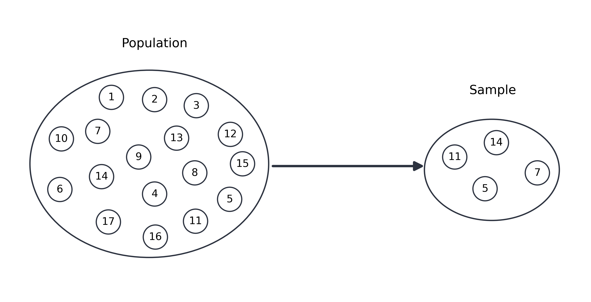
As shown above, a *subset* of a population is known as a sample.

When the data is too large to collect or compute, we often use sample data instead. But there is one important condition: the sample should be **representative of the population** and should not introduce systematic *bias*. This means that we should not select only a particular group of people in a way that could easily alter the outcome.

For example, if I only consider students who have scored 90% or above, the average marks will naturally be very high. But if we consider students with all kinds of marks, ranging from low to high, the sample is more likely to represent the actual population, and therefore, the results are more likely to be closer to the true population value.

The size of the population is denoted by *N*, while the size of the sample is denoted by *n*.

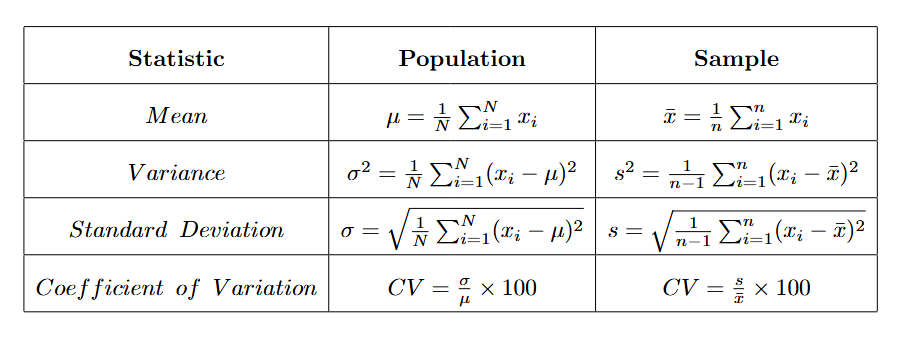

-----

### 2. Why Divide by n − 1? Degrees of Freedom Explained ###

Here, a question may arise — why, in a sample, are we dividing by \(n-1\) and not by \(n\)?

To clear this confusion up, we need to learn something important.

**Do we know that the sum of deviations from the mean is always 0?**

Here is a small proof.

This is our sample mean, right?

$$\bar{x} = \frac{x_1 + x_2 + \cdots + x_n}{n}$$

If we multiply both sides by (n),

$$n\bar{x} = x_1 + x_2 + \cdots + x_n$$

After expanding, we will get something like this, which means the sum of the deviations of each sample point from the mean:

$$(x_1 - \bar{x}) + (x_2 - \bar{x}) + \cdots + (x_n - \bar{x}) = 0$$

It will always be 0.

$$\sum_{i=1}^{n} (x_i - \bar{x}) = 0$$

Now, according to this, let's notice something.

Suppose we have three deviations:


-2, 0, ?


Do we really need all three deviations?

From the other two, I can easily say that the third one has to be (+2). That's the only value that will make the sum equal to 0.

So, out of these 3 deviations, we can independently choose only 2. The last one is automatically determined by the other two.

Therefore, in general, if we have \(n\) deviations from the sample mean, only \(n-1\) of them can vary independently because their sum must be 0.

And this is where we get our first intuition for *Degrees of Freedom.*

But there is one more important point.

When we calculate sample variance, we are using the sample mean instead of the true population mean. Because of this, dividing by (n) would systematically make our estimate of variance a little too small.

Dividing by (n-1) corrects this bias and gives us an unbiased estimate of the population variance.

And that's how, unknowingly, you became familiar with the concept of **Degrees of Freedom**.

Now you might be wondering: why did we take such a long route through populations, samples, and degrees of freedom before even talking about skewness?

Because skewness and kurtosis are statistical measures, and to properly understand their formulas, we need to understand where population and sample formulas come from.

----
### 3. Moments: The Building Blocks of Shape ###

Before we move on to our main topic, I want us to learn one more important concept first, **Moments**.

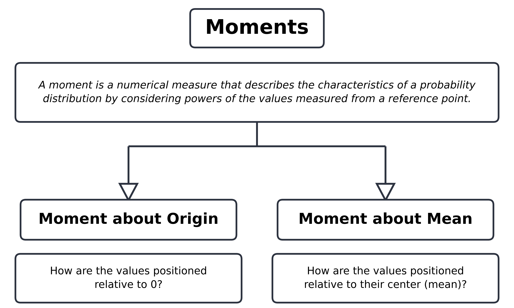

We have four **central moments**:

- **First Central Moment → 0**
- **Second Central Moment → Variance**
- **Third Central Moment → Related to Skewness**
- **Fourth Central Moment → Related to Kurtosis**

We have already gone through the *Mean* and *Variance*, which correspond to the **first raw moment and second central moment**, respectively.

For this blog, we will take a deep dive into the **Third and Fourth Central Moments** and see how, after standardization, they lead to measures of **Skewness and Kurtosis.**

-- First Central Moment  --> **0** --> 
$$\mu_1 = E[(X - \mu)]$$

-- Second Central Moment  --> **Variance** --> 
$$\mu_2 = E[(X - \mu)^2]$$

-- Third Central Moment --> **Related to Skewness** --> 
$$\mu_3 = E[(X - \mu)^3]$$

-- Fourth Central Moment --> **Related to Kurtosis** --> 
$$\mu_4 = E[(X - \mu)^4]$$

These **population moments** are defined using the **population distribution**.

If we want to calculate the corresponding sample moments, we replace the population expectation with the corresponding sample average.

$$m_r = \frac{1}{n} \sum_{i=1}^{n} (x_i - \bar{x})^r$$

----

### 4. Skewness: Measuring Asymmetry ###

### 4.1 Symmetric vs. Skewed Distributions ###

Now we have everything we need to understand our main topic of interest, so let us begin by first understanding what a **Distribution** is.

--> A distribution describes how the values of a variable are distributed and how frequently different values or ranges of values occur. We can simply think of it as a map of our data.

This map could be *Symmetric* or *Non-Symmetric*.

*Symmetric* as in:

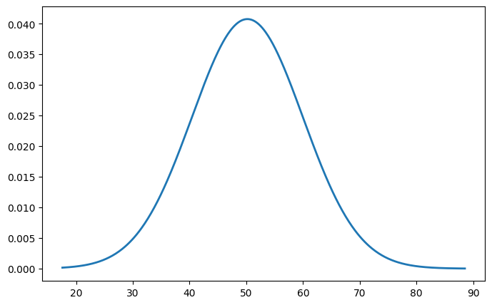

And *non-symmetric distributions* are further classified into two types — **right-skewed and left-skewed distributions.**

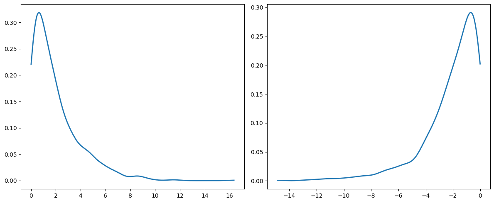

People often get confused because they consider the side with more of the distribution to be the side corresponding to its name. But there is one key thing to remember, always look at the *tail*.

If the long tail extends toward the *right*, then it is **Right-Skewed (Positively Skewed)**.

And if the long tail extends towards the *left*, then it is **Left-Skewed (Negatively Skewed)**.

Here is the Python code generated using 1,000 random data points, showing right-skewed, normal, and left-skewed distributions.

```
import numpy as np
import matplotlib.pyplot as plt
from scipy.stats import gaussian_kde

# Generate data
np.random.seed(42)

# Positive skewness (right-skewed)
positive = np.random.exponential(scale=2, size=1000)

# Normal distribution
normal = np.random.normal(loc=5, scale=1, size=1000)

# Negative skewness (left-skewed)
negative = -np.random.exponential(scale=2, size=1000)


# Function to plot distribution
def plot_distribution(data, title):

    # Mean
    mean = np.mean(data)

    # Median
    median = np.median(data)

    # KDE
    kde = gaussian_kde(data)

    x = np.linspace(min(data), max(data), 1000)
    y = kde(x)

    # Mode = x-value where KDE is maximum
    mode = x[np.argmax(y)]

    # Plot histogram
    plt.hist(
        data,
        bins=30,
        density=True,
        alpha=0.5
    )

    # KDE curve
    plt.plot(
        x,
        y,
        linewidth=2,
        label="KDE"
    )

    # Mean
    plt.axvline(
        mean,
        linewidth=2,
        color = 'red',
        label=f"Mean = {mean:.2f}"
    )

    # Median
    plt.axvline(
        median,
        linewidth=2,
        color = 'green',
        label=f"Median = {median:.2f}"
    )

    # Mode
    plt.axvline(
        mode,
        linewidth=2,
        color = 'black',
        label=f"Mode ≈ {mode:.2f}"
    )

    plt.title(title)
    plt.xlabel("Values")
    plt.ylabel("Density")
    plt.legend()
    plt.show()


# Plot all three
plot_distribution(positive, "Positive Skewness (Right-Skewed)")
plot_distribution(normal, "Normal Distribution")
plot_distribution(negative, "Negative Skewness (Left-Skewed)")
```

### 4.2 Mean, Median and Mode in Skewed Data ###

One more thing we should look at and observe is how the Mean, Median, and Mode are positioned in these three distributions.

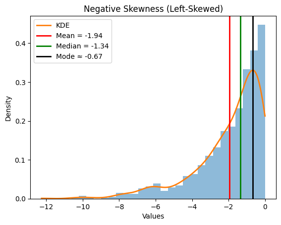

For a **Left-Skewed** *(negatively skewed)* distribution -> **Mean** < **Median** < **Mode**.

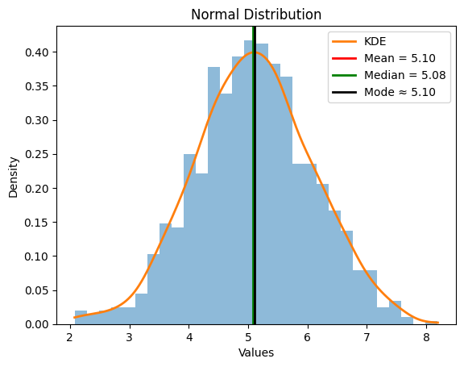

For a **symmetric normal** distribution, we generally observe -> **Mean** ≈ **Median** ≈ **Mode**.


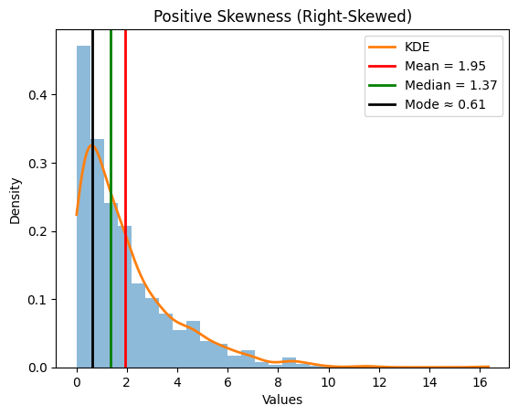

For **Right-Skewed** *(Positively skewed)* distribution we often observe -> **Mean** > **Median** > **Mode**.

The stretch in the tail of a skewed distribution can sometimes be caused by extreme values or outliers on one side of the distribution. However, skewness does not always mean that outliers are present, the distribution itself can naturally have a longer tail on one side.

### 4.3 From the Third Central Moment to Skewness ###

So, moving forward, we have already seen a mathematical glimpse of skewness above while I was explaining the concept of Moments.

--  Third Central Moment --> **Related to Skewness** --> 
$$\mu_3 = E[(X - \mu)^3]$$

As we can see above, I have mentioned it as **Related to Skewness**, not **Skewness** itself. And that perfectly leads us to an important question: **Why are we standardizing it here?**

We just need to standardize it a little bit so that the resulting measure becomes independent of the scale of the data.

$$\gamma_1 = \frac{E[(X - \mu)^3]}{\sigma^3}$$

Here, we divide the **Third Central Moment** by the **cube of the Standard Deviation.**

The Third Central Moment has a **cubed unit**, such as \(cm^3\), \(km^3\), etc. But we don't want our skewness value to depend on the unit in which our data is measured.

So, by dividing it by the cube of the Standard Deviation, we cancel out the units and get a **unitless (dimensionless) value**.

One more important question here could be: **Why do we need to use the third power? Why not square it?**

$$X - \mu $$

represents the distance of a data point from the mean.

If we **square** this distance, both positive and negative deviations become positive. So, we would lose information about the **direction** of the deviation.

But when we **cube** it, something interesting happens:

$$
(+2)^3=+8
$$

while

$$
(-2)^3=-8
$$

The sign is preserved!

This allows the **Third Central Moment** to capture the direction of **asymmetry around the mean.**

There is another important point here. Cubing also gives much greater weight to large deviations. For example:

$$
2^3=8, $$
$$5^3=125
$$

So, extreme values have a much stronger influence on the Third Central Moment. This is one of the reasons why skewness is particularly sensitive to **extreme values and outliers**.

### 4.4 Sample Skewness: Fisher–Pearson and Bias Correction ###

Now, one more important thing to mention, the formulation we saw above is for **Population** data.

But in most real-world problems, we rarely have access to the entire population. We usually work with a **Sample**.

Therefore, we need to adjust the *population* formulation when calculating skewness from *sample data*.

This adjustment leads us to the **Fisher–Pearson sample skewness coefficient**.

$$g_1 = \frac{\frac{1}{n} \sum_{i=1}^{n} (x_i - \bar{x})^3}{\left( \frac{1}{n} \sum_{i=1}^{n} (x_i - \bar{x})^2 \right)^{3/2}}$$

On looking at the formula for the first time, it might look scary, but it is actually quite simple.

It is basically the **third sample central moment divided by the \((3/2)\)-power of the second sample central moment.**

The intuition here is:

- The **Third Sample Central Moment** tells us about the **asymmetric behaviour** of the data.
- The **Second Sample Central Moment** tells us about the **spread or scale of the data**.

So, by dividing the third moment by the \(3/2\) power of the second moment, we are essentially asking,

**How much asymmetry is there relative to the scale of the data?**

This standardization is important because we don't want our skewness value to depend on the units or scale of the data.

But even this estimator has a limitation- it can be biased, particularly for small sample sizes.

Think about it this way, if we repeatedly take different samples from the same population and calculate the skewness of each sample, the values will fluctuate. If we take the average of these sample skewness estimates over many repeated samples, it may systematically differ from the actual population skewness.

We wouldn't simply call this difference a mistake. When an estimator systematically tends to overestimate or underestimate the quantity we are trying to estimate, this systematic difference is called **Bias**.

So, we need a **correction factor**, let's call it *C(n)*.

We can write:

$$G_1=C(n)* g_1$$

This correction factor is derived from the expected behaviour of the sample skewness estimator under repeated sampling.

This leads us to the **Adjusted Fisher–Pearson Skewness Coefficient**.


$$G_1 = \frac{\sqrt{n(n-1)}}{n-2} \, g_1$$

The adjustment slightly changes the estimate to compensate for the systematic bias present in the unadjusted sample skewness.

And as the sample size becomes very large, the correction factor approaches \(1\), so:


$$G_1 -> g_1$$


In other words, **for large samples, the difference between the adjusted and unadjusted skewness becomes very small.**

Here, as we can see, the correction factor only depends on n. But why not something else?

--> We don't want to calculate a different correction based on whether the data is measured in ₹100, ₹10,000, heights, salaries, etc.

The problem we are correcting is primarily a **finite-sample problem**.

So, the correction should depend on the **Sample Size** rather than the actual values or units of the data.

### 4.5 How to Interpret Skewness Values ###

Now, the last thing we need to discuss is the **value of skewness we will get.**

**How will we classify whether our data is highly skewed or mildly skewed?**

There isn't a universal mathematical rule for this because the interpretation of skewness depends heavily on the **context and the data**.

As a rough rule of thumb:

- If **Skewness approx 0** → the data is **approximately symmetric**.
- If **Skewness is positive** → the distribution is **Right-Skewed**.
- If **Skewness is negative** → the distribution is **Left-Skewed**.
- If **|Skewness| is large** → the distribution shows a **stronger degree of asymmetry.**

There are some commonly used rules of thumb, such as considering values above 1 or below -1 as indicating substantial skewness, but these are not universal.

But context matters.

A skewness value of *1* might be perfectly acceptable in one context and problematic in another. There is no single cutoff that can tell us whether skewness is "good" or "bad" for every dataset.

Let us see this through Python code as well, using the same random dataset I showed above.

```
from scipy.stats import skew

print("Positive skewness:", skew(positive))
print("Normal skewness:", skew(normal))
print("Negative skewness:", skew(negative))
```

Positive skewness: 1.865034222864843

Normal skewness: -0.036662811518565

Negative skewness: -1.6510942321423066

From the above results, we can clearly see that the **'+' and '-' signs show us the direction of skewness**.

We can also see that the **Normal Skewness** is slightly negative. We can treat it as **approximately symmetric**. However, a skewness value close to zero alone does not prove that the distribution is **normally distributed**. Therefore, we would not consider this distribution to be meaningfully left-skewed based on its skewness value alone.

We can also clearly see that the **Positive Skewness** is greater in magnitude than the **Negative Skewness**.

But remember, we do **not** compare them simply because a positive number is greater than a negative number. Instead, when comparing the **strength or magnitude of skewness**, we look at their **absolute values**.

For example:


|1.865034222864843| > |-1.651094232142306|


So, the positive-skewed distribution has **slightly stronger skewness** than the negative-skewed distribution.

The important thing to remember is:

**Sign → Direction of skewness**

**Absolute value → Magnitude or strength of skewness**

------

### 5. Kurtosis: It’s About Tails, Not Peaks ###

### 5.1 What Kurtosis Really Measures ###

While going through many sites and researching about **Kurtosis**, I got to know that people usually describe it as the **“peakedness”** of a distribution.

But is it really so?

**Not exactly.**

**Kurtosis** is a **standardized fourth central moment** that is particularly **sensitive to extreme observations and tail behaviour.**

In simple words, it helps us understand the **relative importance of extreme observations and tail behaviour.**

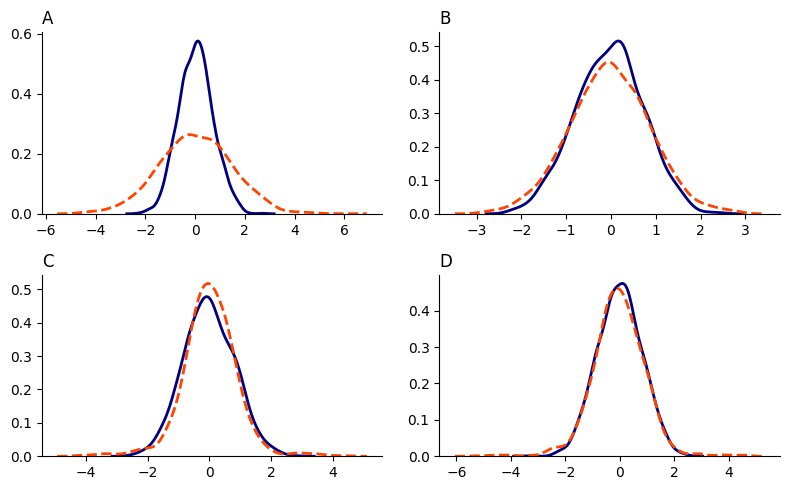

In the above image, can you focus on the different patterns of the **tails**?

Yes, these differences in tail behaviour are related to **Kurtosis.**

As we learned earlier in this blog while understanding the formulation of Skewness, a similar pattern applies to Kurtosis as well.

$$\beta_2 = \frac{E[(X - \mu)^4]}{\sigma^4}$$

which on expanding will give us:

$$\beta_2 = \frac{E[(X - \mu)^4]}{\left( E[(X - \mu)^2] \right)^2}$$

Here, we simply take the **Fourth Central Moment** and, to standardize it, divide it by the **fourth power of the Standard Deviation**.

Here is a simple flowchart to help us remember it effectively.

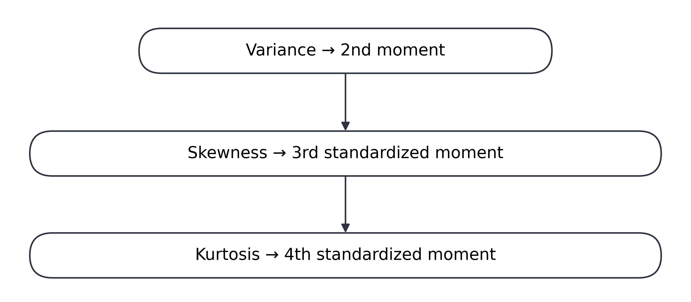

But as we know, this formulation is for **Population** data, and we usually do not have access to the entire population. So, we need a **Sample** formula to apply.

But before getting there, I want us to learn one more important concept, **Excess Kurtosis**.

### 5.2 Why the Fourth Power? ###

Before going further, another question may arise here:

**Why the 4th power?**

As we wanted to know the **direction** in Skewness, we used the **3rd power**, which preserves the sign of the deviation.

But here, we want deviations on both sides of the mean to contribute positively, while also giving much greater weight to large deviations. The **4th power** does exactly that.

For example:

$$
(-2)^4 = 16
$$

and

$$
(2)^4 = 16
$$

So, both positive and negative deviations contribute positively.

But that's not the only reason we use the 4th power.

The fourth power also gives **extreme values a disproportionately large weight**.

For example:

\[
10^4 = 10,000
\]

This means that as an observation gets farther away from the mean, its contribution to the Fourth Central Moment increases very rapidly.

So, **Kurtosis doesn't just care that an observation is far away, the fourth power makes it care much more as the observation gets farther away.**

### 5.3 Excess Kurtosis: Where Does the “3” Come From? ###

Now, let's move towards **Excess Kurtosis**.

To understand Excess Kurtosis, we first need to look at the different values of **Kurtosis**:

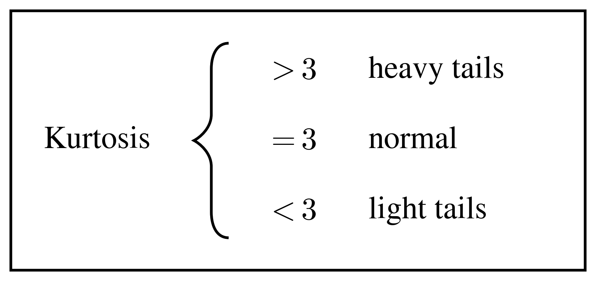

And to understand where this **3** came from, we must know a little more about the **Normal Distribution**.

$$Z = \frac{X - \mu}{\sigma}$$

This is the **Standard Normal Random Variable**, which is obtained when we take any point \(X\) from a normal distribution, subtract the mean, and divide it by the **standard deviation**:

This transformation is called **standardization**.

It becomes a special case of the Normal Distribution when the mean is \(0\) and the standard deviation is \(1\) i.e

Z ~ N(0,1)

So, for the **Standard Normal Distribution**, the mean is \(0\) and the standard deviation is \(1\).

Now, for **Kurtosis**, we are interested in the Fourth Central Moment:

$$E[(X - \mu)^4] = E[(\sigma Z)^4] = \sigma^4 E[Z^4]$$

For a Standard Normal Random Variable, the even moments follow a very interesting pattern:

$$E[Z^{2k}] = (2k - 1)!!$$

For k=2, we are dealing with the **Fourth Moment**.

Here, (!!) represents the **Double Factorial**, which means we multiply every other number as we move downward:

3!! = 3 × 1 = 3

And that's where our famous **3** comes from!

$$K = \frac{E[(X - \mu)^4]}{\sigma^4} = \frac{3\sigma^4}{\sigma^4} = {3}$$

So, we can say that the **kurtosis of a Normal Distribution is 3.**

That's why we use **3 as the baseline** when interpreting Kurtosis.

However, the raw Kurtosis values are not always very intuitive to interpret. For example, saying that a distribution has a Kurtosis of \(5\) doesn't immediately tell us much.

So, we make the interpretation easier by subtracting the Normal Distribution's Kurtosis, which is \(3\).

Therefore:

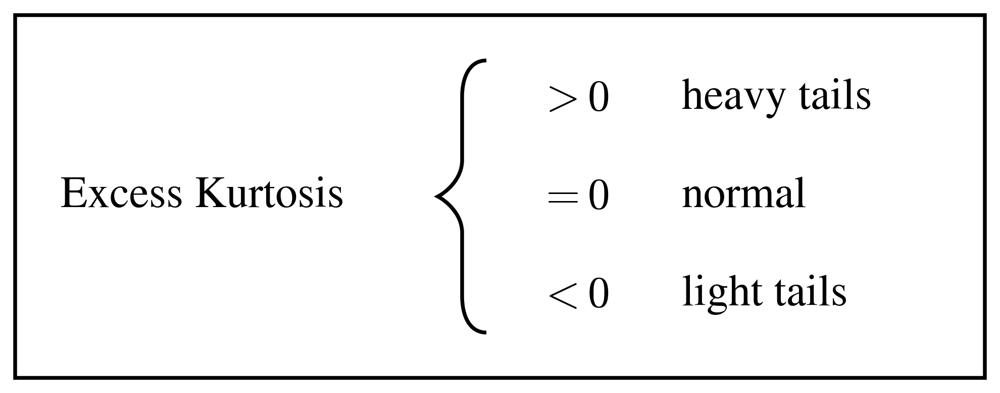

Now the interpretation becomes much simpler:

- **Excess Kurtosis \(>0\)** → generally indicates heavier tails and greater sensitivity to extreme observations than the Normal Distribution
- **Excess Kurtosis \(=0\)** → same kurtosis as the Normal Distribution
- **Excess Kurtosis \(<0\)** → generally indicates lighter tails and less sensitivity to extreme observations than the Normal Distribution

### 5.4 Leptokurtic, Mesokurtic and Platykurtic Distributions ###

Let us see this through graphs:

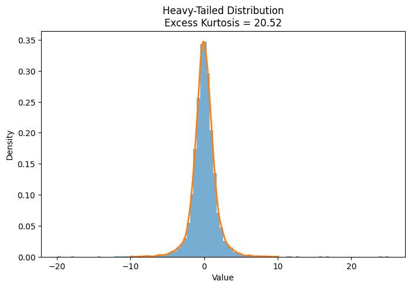

As we can clearly see in the above graph, the value of **Excess Kurtosis = 20.52**, which is very high compared to \(0\).

This indicates that the distribution has **higher kurtosis and typically heavier tails, with greater sensitivity to extreme observations than a Normal Distribution**. Such a distribution is commonly referred to as **Leptokurtic**.

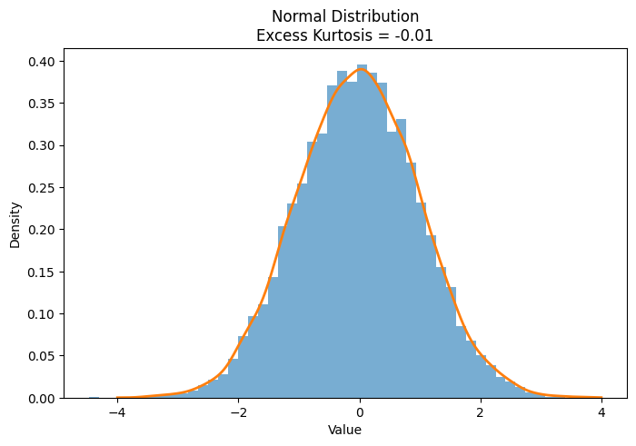

Here, the **Excess Kurtosis = -0.01**, which is very close to \(0\).

This tells us that the distribution has approximately the same kurtosis as a Normal Distribution, so we can consider it approximately **Mesokurtic**. However, this does not mean that the distribution is necessarily normally distributed.

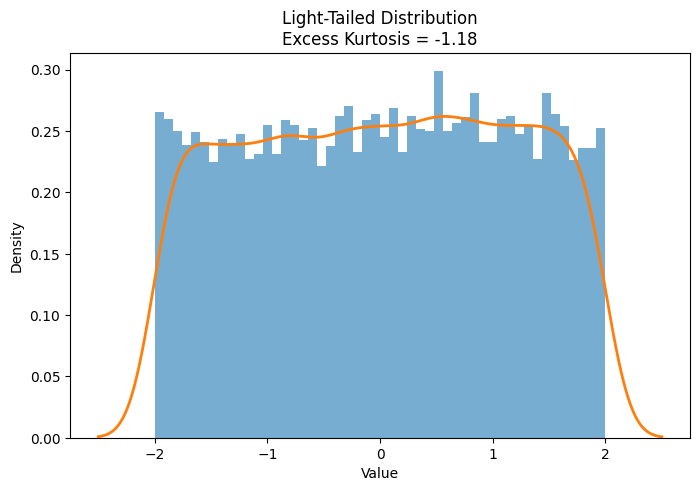

Here, the **Excess Kurtosis = -1.18**.

Since the excess kurtosis is *negative*, the distribution has lower kurtosis than a *Normal Distribution* and typically less influence from extreme observations. Such a distribution is commonly referred to as **Platykurtic**.

As you can see, these differences in the tails are also quite evident from the graphs themselves.

Here is the Python code used to generate the above graphs:

```
import numpy as np
import matplotlib.pyplot as plt
from scipy.stats import kurtosis, gaussian_kde

np.random.seed(42)

# 1. Heavy-tailed distribution
heavy = np.random.standard_t(df=3, size=10000)

# 2. Normal distribution
normal = np.random.normal(loc=0, scale=1, size=10000)

# 3. Light-tailed distribution
light = np.random.uniform(-2, 2, size=10000)


# Calculate excess kurtosis
print("Heavy-tail kurtosis:", kurtosis(heavy))
print("Normal kurtosis:", kurtosis(normal))
print("Light-tail kurtosis:", kurtosis(light))


# -------------------------
# Heavy-tailed distribution
# -------------------------
plt.figure(figsize=(8, 5))

plt.hist(heavy, bins=100, density=True, alpha=0.6)

# KDE
x = np.linspace(-10, 10, 1000)
kde = gaussian_kde(heavy)
plt.plot(x, kde(x), linewidth=2)

plt.title(f"Heavy-Tailed Distribution\nExcess Kurtosis = {kurtosis(heavy):.2f}")
plt.xlabel("Value")
plt.ylabel("Density")
plt.show()


# -------------------------
# Normal distribution
# -------------------------
plt.figure(figsize=(8, 5))

plt.hist(normal, bins=50, density=True, alpha=0.6)

# KDE
x = np.linspace(-4, 4, 1000)
kde = gaussian_kde(normal)
plt.plot(x, kde(x), linewidth=2)

plt.title(f"Normal Distribution\nExcess Kurtosis = {kurtosis(normal):.2f}")
plt.xlabel("Value")
plt.ylabel("Density")
plt.show()


# -------------------------
# Light-tailed distribution
# -------------------------
plt.figure(figsize=(8, 5))

plt.hist(light, bins=50, density=True, alpha=0.6)

# KDE
x = np.linspace(-2.5, 2.5, 1000)
kde = gaussian_kde(light)
plt.plot(x, kde(x), linewidth=2)

plt.title(f"Light-Tailed Distribution\nExcess Kurtosis = {kurtosis(light):.2f}")
plt.xlabel("Value")
plt.ylabel("Density")
plt.show()
```

By default, SciPy's kurtosis() function returns Fisher's excess kurtosis, where the Normal Distribution has a value of 0.

### 5.5 Sample Kurtosis and Fisher’s Correction ###

Now, as we are clear about **Excess Kurtosis**, we are actually one step closer to our **Sample Data** formula for Kurtosis.

$$\begin{aligned}
g_2 &= \frac{m_4}{m_2^2} - 3 \\
m_2 &= \frac{1}{n} \sum_{i=1}^{n} (x_i - \bar{x})^2 \\
m_4 &= \frac{1}{n} \sum_{i=1}^{n} (x_i - \bar{x})^4
\end{aligned}$$

Here, \(g_2\) represents the **sample excess kurtosis**.

As we learned earlier, we obtain **excess kurtosis** by dividing the Fourth Central Moment by the square of the Second Central Moment and then subtracting (3), the kurtosis of a **Normal Distribution.**

But just like we saw with Skewness, this estimator has a **small-sample bias**.

Therefore, we apply a correction to obtain the **Bias-Corrected Sample Excess Kurtosis**, also known as **Fisher's correction**.

$$G_2 = \frac{n-1}{(n-2)(n-3)} \left[ (n+1) \left( \frac{m_4}{m_2^2} - 3 \right) + 6 \right]$$


This is the **Bias-Corrected Sample Excess Kurtosis (Fisher's correction).**

One last important thing to keep in mind before we move on.

As I mentioned before, people often associate **Kurtosis** with **peakedness**. But this is not always true and should not be the centre of its definition.

**Two distributions can have similar peaks but very different tail behaviour.**

Therefore:

> **Kurtosis is strongly related to tail behaviour and the influence of extreme observations, rather than simply being a measure of peak height.**

### 5.6 Skewness vs. Kurtosis: The Memory Map ###

And with that, I will end this section with a **Memory Map** for you all.

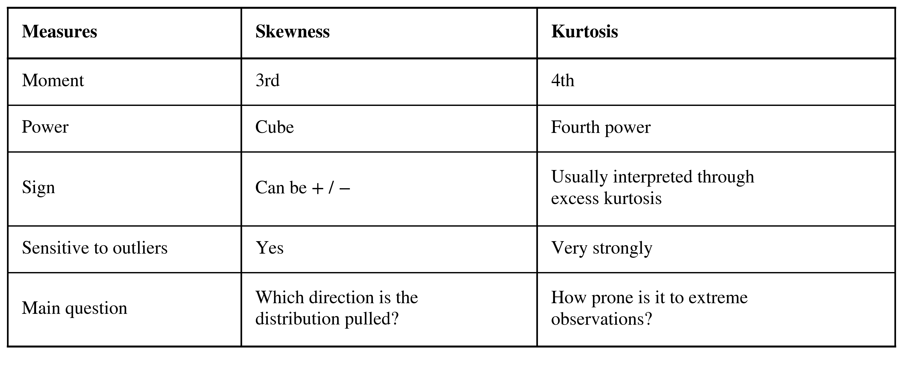

**A subtle but VERY important point**

A distribution can have **High Skewness** but **Low Kurtosis**, or **Low Skewness** but **High Kurtosis**.

Why?

Because **Skewness and Kurtosis measure two different aspects of a distribution**:

- **Skewness** → tells us about the **asymmetry and direction** of the distribution.
- **Kurtosis** → tells us about the **behaviour of extreme values and the tails**.

So, a distribution can be almost perfectly symmetric while still having very heavy or very light tails.

A key thing to remember is that **symmetry does not tell us anything about the behaviour of extreme values**.

----

### 6. Calculating Skewness and Kurtosis in Python ###

I have provided the Python codes above, but once again, I'll give you the functions we can use to calculate **Skewness** and **Kurtosis**.

```
import pandas as pd

df["variable"].skew()
df["variable"].kurt()
```
The pandas kurt() function returns Fisher's sample excess kurtosis with a bias correction by default.

```
from scipy.stats import skew, kurtosis

skew(df["variable"])
kurtosis(df["variable"])
```
Or we can use SciPy.
By default, SciPy's skew() calculates the biased sample skewness, while kurtosis() returns the biased Fisher excess kurtosis unless the corresponding bias correction options are changed.

----

### 7. Taming Skewness: Data Transformations ###

Can we judge whether our data is **good or bad** just by looking at the value of **Skewness**?

Before coming to any conclusion, we must first ask,

**Is the skewness genuine? Is it caused by extreme values or outliers? Does it actually affect our analysis or the ML algorithm we are going to use? Or could a transformation help?**

**Skewness itself is not necessarily a problem.** Its importance depends on the nature of the data, the purpose of the analysis, and the **ML algorithm** being used.

As I mentioned above, we can apply different **Transformations** to reduce skewness. Now, let's discuss them one by one.

### 7.1. Log Transformation

As the name itself suggests, we take the **logarithm of the values**.

A log transformation compresses large values more strongly than smaller values, which can significantly reduce **strong right skewness**.

Why not usually for **Left Skewness**?

The standard logarithm is defined only for *positive values*, so we cannot directly apply it to data containing zero or negative values.

For left-skewed data, we may need to consider a different transformation, depending on the nature of the data.

### 7.2. Square Root Transformation

Again, as the name suggests, we take the **square root of the values**.

It compresses larger values, but less aggressively than a logarithmic transformation, so it can be useful for **moderate right skewness**.

However, like the ordinary square-root function, it requires non-negative values.

### 7.3. Cube Root Transformation

Here, we take the **cube root of the values**.

One useful property of the cube root is that it can be applied to **negative as well as positive values**.

Therefore, it can be useful for reducing both **right and left skewness**, depending on the data.

### 7.4. Box-Cox Transformation

The **Box-Cox Transformation** is named after the two statisticians who introduced the method, **George Box** and **David Cox**.

It is a statistical technique that searches for a suitable value of *(lambda)* to transform the data, often with the goal of making the distribution more symmetric or improving the assumptions of a statistical model.

The transformation is:

$$X^{(\lambda)} =
\begin{cases}
\dfrac{X^\lambda - 1}{\lambda}, & \lambda \neq 0 \\
\ln(X), & \lambda = 0
\end{cases}$$

If:

$$
\lambda = 0
$$

Box–Cox transformation corresponds to a **logarithmic transformation.**

For:

$$\lambda \neq 0$$

the corresponding power transformation is applied.

One important limitation to remember is that the standard **Box-Cox transformation requires strictly positive data**.

Here is a Python example showing how these transformations work:

```
 import numpy as np
import matplotlib.pyplot as plt
from scipy.stats import boxcox
import seaborn as sns

# Skewed positive data
X = np.array([
    10, 12, 15, 18, 20, 25,
    30, 40, 60, 100, 150, 300
])

# Apply Box-Cox
X_boxcox, lambda_boxcox = boxcox(X)

print("Box-Cox lambda:", lambda_boxcox)

# Create plots
plt.figure(figsize=(12, 5))

# Original data
plt.subplot(1, 2, 1)
sns.histplot(X, kde=True, bins=8)
plt.title("Original Data")
plt.xlabel("Value")
plt.ylabel("Density")

# Box-Cox transformed data
plt.subplot(1, 2, 2)
sns.histplot(X_boxcox, kde=True, bins=8)
plt.title(f"Box-Cox Transformed (λ = {lambda_boxcox:.2f})")
plt.xlabel("Transformed Value")
plt.ylabel("Density")

plt.tight_layout()
plt.show()
```
*Box-Cox lambda: -0.3978727501273978*

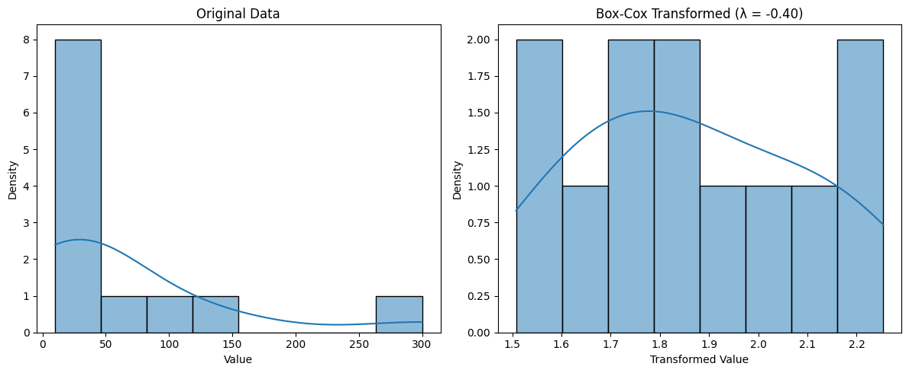

### 7.5. Yeo-Johnson Transformation

The **Yeo-Johnson Transformation** is named after the researchers **In-Kwon Yeo** and **Richard A. Johnson**, who introduced the method in 2000.

The **Yeo–Johnson transformation** is similar in purpose to the **Box–Cox transformation**, but it can handle zero and negative values.

This means that data containing **zero or negative values** cannot be directly handled by the standard *Box-Cox Transformation*.


It can handle:


             X > 0 , X = 0 , X < 0


So, unlike Box-Cox, the Yeo-Johnson Transformation can be applied to data containing **positive, zero, and negative values**.

The goal remains similar, to find a suitable transformation that can reduce skewness and make the distribution more symmetric.

Here is the Python code example for you:

```
import numpy as np
import matplotlib.pyplot as plt
from scipy.stats import yeojohnson
import seaborn as sns

# Data containing negative, zero and positive values
X = np.array([
    -100, -50, -30, -20, -10,
    -5, 0, 2, 5, 10, 20, 50, 100, 200
])

# Apply Yeo-Johnson
X_yeojohnson, lambda_yeojohnson = yeojohnson(X)

print("Yeo-Johnson lambda:", lambda_yeojohnson)

# Create plots
plt.figure(figsize=(12, 5))

# Original data
plt.subplot(1, 2, 1)
sns.histplot(X, kde=True, bins=8)
plt.title("Original Data")
plt.xlabel("Value")
plt.ylabel("Density")

# Yeo-Johnson transformed data
plt.subplot(1, 2, 2)
sns.histplot(X_yeojohnson, kde=True, bins=8)
plt.title(f"Yeo-Johnson Transformed (λ = {lambda_yeojohnson:.2f})")
plt.xlabel("Transformed Value")
plt.ylabel("Density")

plt.tight_layout()
plt.show()
```
*Yeo-Johnson lambda: 0.9090980955368206*

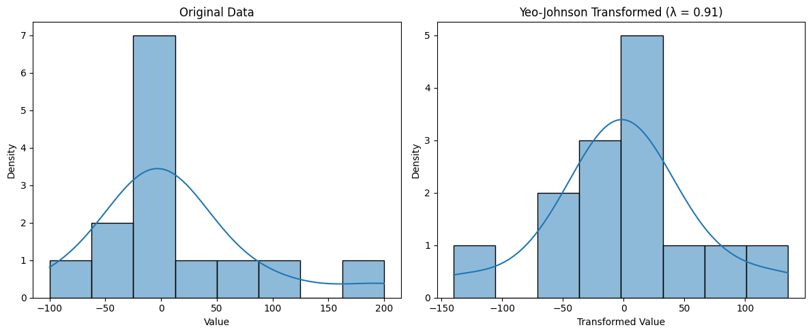
-
---

### 8. Standardization vs. Transformation ###


One must have complete clarity about two things here:

**Standardization vs Skewness**

and

**Standardization vs Transformation**

### Standardization

$$Z = \frac{X - \mu}{\sigma}$$

**Standardization** transforms the data so that its **mean** becomes 0 and its **standard deviation** becomes 1.

Why?

Because **standardization changes the location and scale** of the data but does not change the distribution's shape in the sense relevant to measures such as **skewness and kurtosis**.

On the other hand,

**Transformation** can change the **shape of the distribution** and potentially reduce skewness.

So, remember:

> **Standardization changes the scale. Transformation can change the shape.**

---

### 9. Kurtosis in Machine Learning ###

Now that we understand the mathematics behind **Kurtosis**, an important question remains: **How can it be useful in Machine Learning?**

Kurtosis can help us investigate the influence of **extreme observations and tail behaviour relative to a normal distribution.**

If we observe high kurtosis, it gives us a reason to investigate further.

We can look for:

- **Outliers**
- **Data quality issues**
- **Genuine extreme observations**

But remember:

**High Kurtosis does not automatically mean that we should remove the extreme values.**

An extreme observation could be a genuine and important part of the data. Removing it without understanding its origin can actually damage our analysis.

---

### 10. A Practical EDA Workflow ###

For a numerical feature, we can examine ->

- **Mean**
- **Median**
- **Standard Deviation**
- **Skewness**
- **Kurtosis**

Then, through visualizations such as ->

- **Histogram**
- **Boxplot**
- **KDE Plot**
- **Q-Q Plot**

we can better understand the distribution of our data.

Together, these statistical summaries and visualizations form an important part of **Exploratory Data Analysis (EDA)**.

And with that, I will end this blog with a **Flowchart for EDA**.

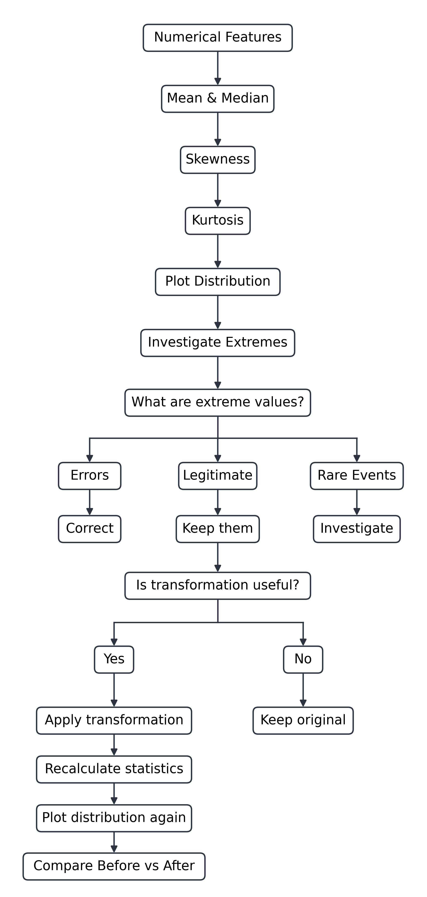

-----

### 11. Resources

1. **SciPy Documentation — Statistical Functions**
   Used for the implementation and behaviour of functions such as `skew()`, `kurtosis()`, `boxcox()`, and `yeojohnson()`.

2. **SciPy Documentation — `scipy.stats.skew`**
   Reference for calculating sample skewness and understanding the `bias` parameter.

3. **SciPy Documentation — `scipy.stats.kurtosis`**
   Reference for Fisher's excess kurtosis and the bias-correction options.

4. **SciPy Documentation — `scipy.stats.boxcox`**
   Reference for the Box–Cox transformation and its implementation.

5. **SciPy Documentation — `scipy.stats.yeojohnson`**
   Reference for the Yeo–Johnson transformation and its implementation.

6. **Pandas Documentation — Descriptive Statistics**
   Reference for `.skew()` and `.kurt()` used in the practical examples.

7. **NIST/SEMATECH e-Handbook of Statistical Methods** - 
   Reference for statistical concepts including moments, skewness, kurtosis, distributions, and exploratory data analysis.

8. **George E. P. Box & David R. Cox (1964)** - 
   *An Analysis of Transformations.*
   **Journal of the Royal Statistical Society: Series B**, 26(2), 211–252.
   — Original paper introducing the Box–Cox transformation.

9. **In-Kwon Yeo & Richard A. Johnson (2000)** - 
   *A New Family of Power Transformations to Improve Normality or Symmetry.*
   **Biometrika**, 87(4), 954–959.
   — Original paper introducing the Yeo–Johnson transformation.

10. **Joanes, D. N. & Gill, C. A. (1998)** - 
    *Comparing Measures of Sample Skewness and Kurtosis.*
    **Journal of the Royal Statistical Society: Series D (The Statistician)**, 47(1), 183–189.
    — Useful reference for different sample estimators of skewness and kurtosis.


------

**Image and Figure Credits:** All figures in this article were created by the author using Python or Lucidchart. The featured image was AI-generated.

-----


